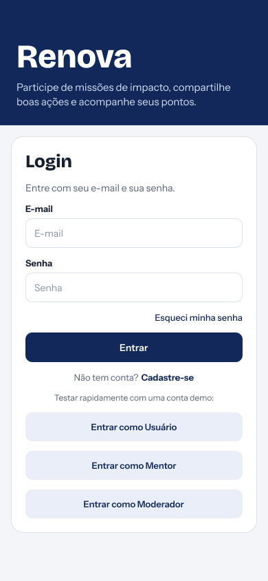
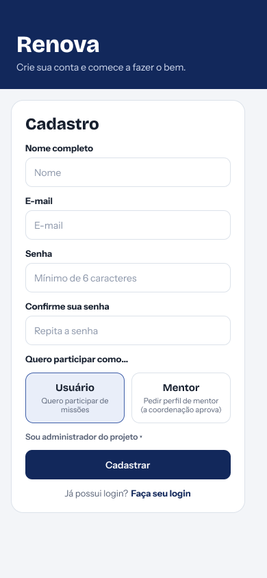
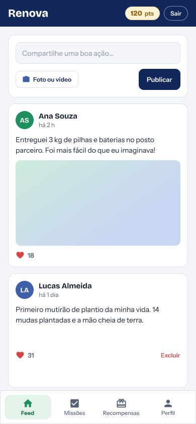
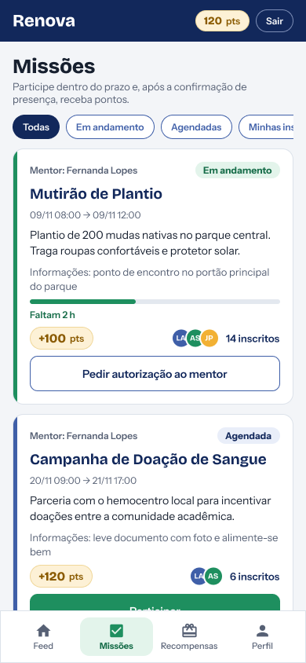
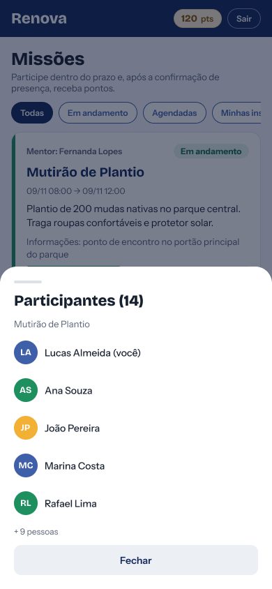
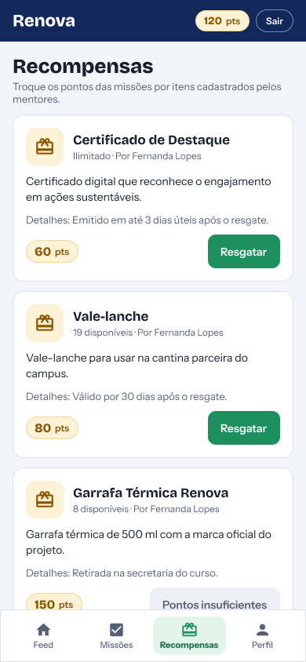
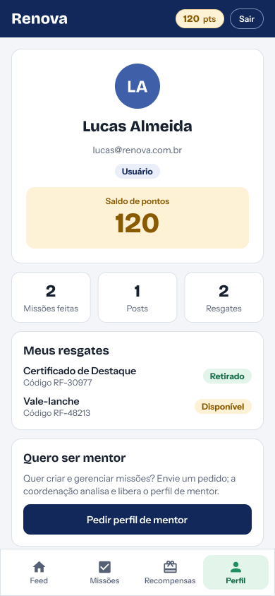
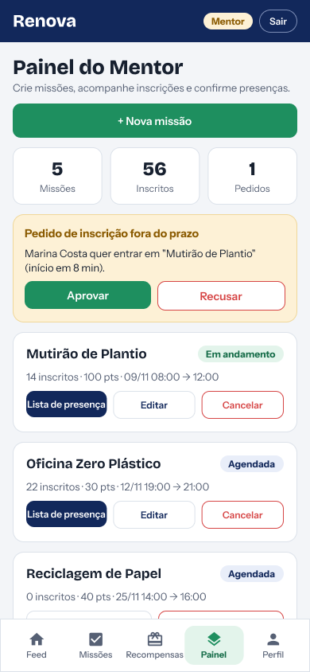
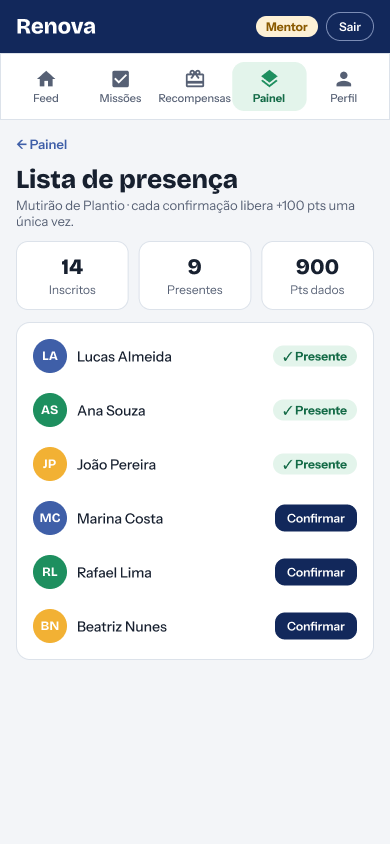

# RenovaFacens

Projeto desenvolvido para a disciplina Usina de Projetos Experimentais 2 (UPX 2) do curso de Análise e Desenvolvimento de Sistemas (ADS) do Centro Universitário Facens.

Orientador: Prof. Evandro Klengenfuss Veronez.

## Sobre o projeto

A FACENS, por meio da LIS Facens, promove iniciativas beneficentes e de sustentabilidade, como doação de sangue, conscientização sobre o descarte adequado de resíduos e arrecadação de doações. O desafio é ampliar a participação da comunidade acadêmica e externa nessas ações.

O RenovaFacens é um aplicativo que incentiva a realização de boas ações por meio de recompensas. Os usuários participam de missões solidárias e ambientais, têm a presença confirmada por um mentor, acumulam pontos e podem trocá-los por prêmios e benefícios. Os prêmios são oferecidos por apoiadores (empresas e comércios parceiros) e cadastrados no aplicativo pelos mentores.

## Perfis de usuário

| Perfil no aplicativo | Equivalente na documentação | O que faz |
|---|---|---|
| **Usuário** | Estudante | Público principal. Participa de missões, acumula pontos, publica boas ações no feed e resgata recompensas (prêmios ou horas complementares). |
| **Mentor** | Embaixador | Líder da missão. Cria e gerencia missões, aprova inscrições fora do prazo, confirma a lista de presença e cadastra as recompensas. |
| **Moderador** | Administrador do projeto | Analisa os pedidos de perfil de mentor. |

Quem se cadastra como usuário pode pedir o perfil de mentor, que depende de aprovação da coordenação.

## O que este repositório contém

Esta etapa do projeto concentrou-se na modelagem e na estruturação lógica do sistema:

- **Protótipo de interface (UI/UX):** focado no usuário, priorizando a intuitividade, a rapidez no aceite das missões e a clareza no extrato de pontos e recompensas. Cobre o fluxo desde a visualização da missão pelo usuário até a confirmação de presença pelo mentor.
- **Banco de dados:** modelagem relacional e script de criação (`schema.sql`).

Protótipo no Figma: [adicionar link do protótipo aqui]

## Telas do protótipo

| Tela | Descrição |
|---|---|
|  | **Login:** entrada com e-mail e senha, recuperação de senha e contas de demonstração. |
|  | **Cadastro:** criação de conta como usuário ou com pedido de perfil de mentor. |
|  | **Feed:** publicação de boas ações com foto ou vídeo, curtidas e exclusão das próprias postagens. |
|  | **Missões:** lista com filtros (em andamento, agendadas, minhas inscrições), pontos, prazo e inscritos. Em missões já iniciadas, o usuário pede autorização ao mentor. |
|  | **Participantes:** lista de inscritos de uma missão. |
|  | **Recompensas:** troca de pontos por prêmios, com estoque e aviso de pontos insuficientes. |
|  | **Perfil:** saldo de pontos, missões feitas, posts, resgates com código e pedido de perfil de mentor. |
|  | **Painel do Mentor:** criação, edição e cancelamento de missões, e aprovação de inscrições fora do prazo. |
|  | **Lista de presença:** confirmação de presença, que libera os pontos da missão uma única vez por participante. |

## Banco de dados

O script `schema.sql` cria o banco `renovafacens` com as seguintes tabelas:

- `USUARIO`: usuários, mentores e moderadores (campo `papel`).
- `PEDIDO_MENTOR`: pedidos de perfil de mentor e a resposta do moderador.
- `MISSAO`: missões criadas por um mentor.
- `PARTICIPACAO`: inscrição, pedido de entrada fora do prazo e presença de um usuário em uma missão, com os pontos ganhos.
- `RECOMPENSA`: prêmios e brindes cadastrados por mentores, com custo em pontos e estoque (vazio significa ilimitado).
- `RESGATE`: troca de pontos de um usuário por uma recompensa, com código de retirada.
- `POSTAGEM` e `CURTIDA`: publicações do feed e curtidas.

O saldo de pontos de cada usuário pode ser consultado na view `VW_SALDO_PONTOS`.

Para criar o banco, execute o script no MySQL/MariaDB (por linha de comando ou importando pelo phpMyAdmin):

```bash
mysql -u <usuario> -p < schema.sql
```

### Padrão de nomes do banco

- Tabelas em MAIÚSCULAS e no singular.
- Colunas em snake_case minúsculo.
- Chave primária no formato `id_<tabela>` (ex.: `id_usuario`, `id_missao`). Chaves estrangeiras usam o mesmo nome da chave que referenciam, exceto quando o papel da relação importa (ex.: `id_mentor`).
- O estado de um registro sempre se chama `situacao`, com valores em MAIÚSCULAS (ex.: `EM_ANDAMENTO`).
- Datas de início e fim usam `data_inicio` e `data_fim`.

## Tecnologias

- Prototipação: Figma
- Banco de dados: MySQL/MariaDB

## Equipe

| Integrante | Funções |
|---|---|
| Caio Kenzo Grigoleto | Gestor do Projeto, Especialista em Deploy |
| Enzo Valentim Garcia | Product Owner, Analista de Requisitos |
| Henrique Nóbrega | Analista de Suporte, Analista de Requisitos |
| Luis Filipe Gonçalves Cintra | Desenvolvedor Back-end, Engenheiro de Teste |
| Naiara Alves Fioravanti Nunes (líder) | Scrum Master, Desenvolvedor Front-end, Designer UI/UX, Gestora de Projetos |
| Victor de Moraes Leite | Desenvolvedor Back-end, Engenheiro de Teste |
