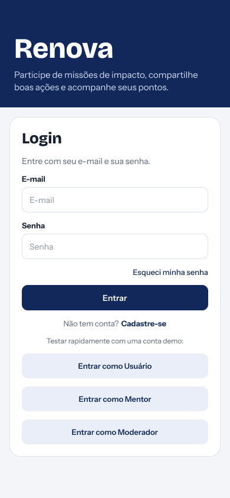
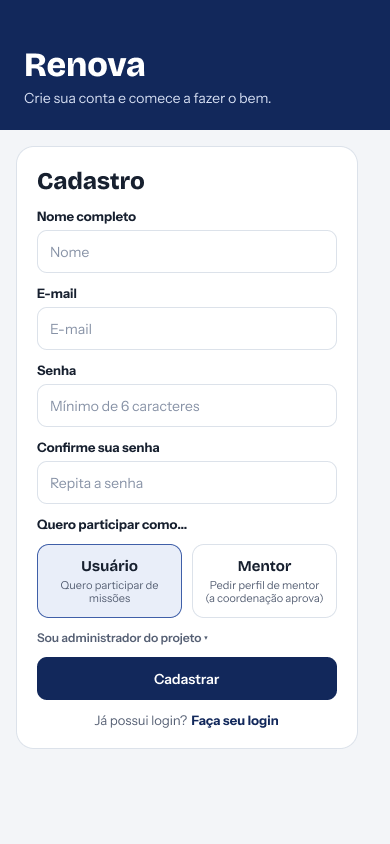
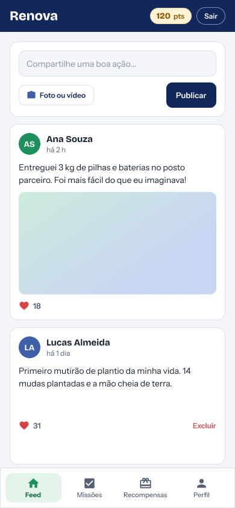
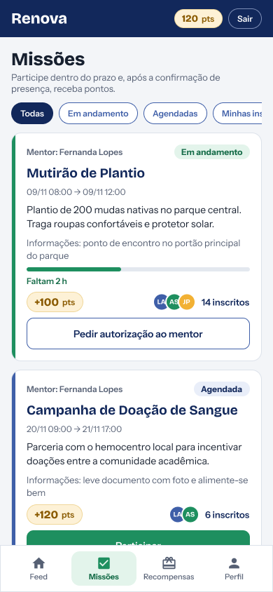
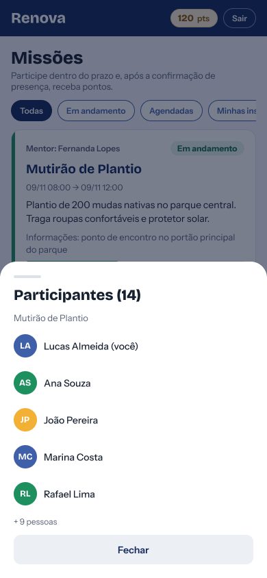
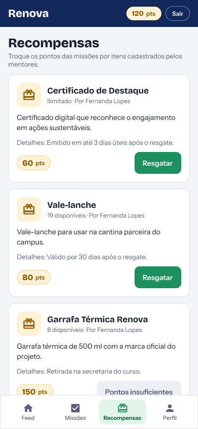
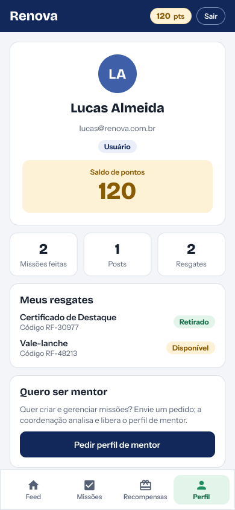
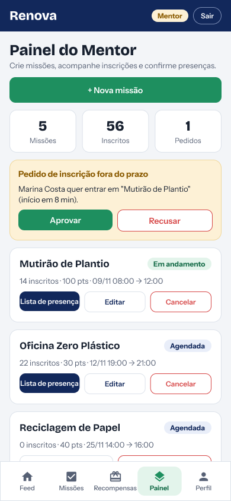
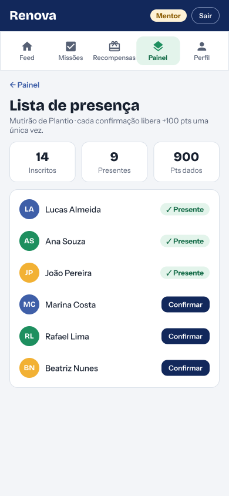

## Telas do protótipo

O protótipo foi desenhado para uso no celular e organizado em três fluxos: acesso à conta, jornada do usuário e gestão pelo mentor.

### Acesso

<table>
<tr>
<td width="260"></td>
<td valign="top">

**Login**

Porta de entrada do aplicativo.

<ul>
<li>Entrada com e-mail e senha, com opção de recuperar a senha.</li>
<li>Link para o cadastro de quem ainda não tem conta.</li>
<li>Botões de conta de demonstração (Usuário, Mentor e Moderador) para testar cada perfil rapidamente.</li>
</ul>

</td>
</tr>
<tr>
<td width="260"></td>
<td valign="top">

**Cadastro**

Criação de conta em poucos campos.

<ul>
<li>Nome completo, e-mail, senha (mínimo de 6 caracteres) e confirmação de senha.</li>
<li>Escolha de como participar: como <b>Usuário</b>, para participar de missões, ou como <b>Mentor</b>, que envia um pedido de perfil analisado pela coordenação.</li>
<li>Acesso separado para administradores do projeto.</li>
</ul>

</td>
</tr>
</table>

### Jornada do usuário

<table>
<tr>
<td width="260"></td>
<td valign="top">

**Feed**

Espaço da comunidade para compartilhar boas ações.

<ul>
<li>Campo de publicação com texto e anexo opcional de foto ou vídeo.</li>
<li>Cada postagem mostra autor, tempo desde a publicação, texto, mídia e número de curtidas.</li>
<li>O autor pode excluir as próprias postagens.</li>
<li>O saldo de pontos fica visível no topo em todas as telas do usuário.</li>
</ul>

</td>
</tr>
<tr>
<td width="260"></td>
<td valign="top">

**Missões**

Lista das missões solidárias e ambientais.

<ul>
<li>Filtros: Todas, Em andamento, Agendadas e Minhas inscrições.</li>
<li>Cada cartão mostra o mentor responsável, a situação, o título, o período, a descrição e as informações adicionais (como ponto de encontro e o que levar).</li>
<li>Missões em andamento exibem barra de progresso e o tempo restante.</li>
<li>Pontos oferecidos, avatares e total de inscritos aparecem em destaque.</li>
<li>Em missões agendadas, o usuário se inscreve com <b>Participar</b>. Em missões já iniciadas, ele usa <b>Pedir autorização ao mentor</b>.</li>
</ul>

</td>
</tr>
<tr>
<td width="260"></td>
<td valign="top">

**Participantes**

Painel que abre ao tocar nos inscritos de uma missão.

<ul>
<li>Lista de quem está inscrito, com o total no título.</li>
<li>O próprio usuário é identificado com "(você)".</li>
<li>As pessoas restantes aparecem resumidas em "+N pessoas".</li>
</ul>

</td>
</tr>
<tr>
<td width="260"></td>
<td valign="top">

**Recompensas**

Troca dos pontos acumulados por itens cadastrados pelos mentores.

<ul>
<li>Cada item mostra nome, mentor responsável, estoque (ilimitado ou quantidade disponível), descrição e detalhes de validade ou retirada.</li>
<li>O custo em pontos aparece junto ao botão <b>Resgatar</b>.</li>
<li>Quando o saldo não é suficiente, o botão é substituído por <b>Pontos insuficientes</b>.</li>
</ul>

</td>
</tr>
<tr>
<td width="260"></td>
<td valign="top">

**Perfil**

Resumo da conta e da atividade do usuário.

<ul>
<li>Nome, e-mail, perfil e saldo de pontos.</li>
<li>Totais de missões feitas, posts publicados e resgates realizados.</li>
<li>Lista de resgates com código de retirada e situação (Disponível ou Retirado).</li>
<li>Opção <b>Pedir perfil de mentor</b>, que envia o pedido para análise da coordenação.</li>
</ul>

</td>
</tr>
</table>

### Gestão pelo mentor

<table>
<tr>
<td width="260"></td>
<td valign="top">

**Painel do Mentor**

Central de controle das missões criadas pelo mentor.

<ul>
<li>Botão <b>Nova missão</b> e resumo com total de missões, inscritos e pedidos pendentes.</li>
<li>Aviso de pedido de inscrição fora do prazo, com <b>Aprovar</b> e <b>Recusar</b>.</li>
<li>Lista das missões do mentor com situação, inscritos, pontos e período.</li>
<li>Ações por missão: <b>Lista de presença</b>, <b>Editar</b> e <b>Cancelar</b>.</li>
</ul>

</td>
</tr>
<tr>
<td width="260"></td>
<td valign="top">

**Lista de presença**

Confirmação de quem realmente participou da missão.

<ul>
<li>Resumo com inscritos, presentes e pontos já distribuídos.</li>
<li>Quem já foi confirmado aparece como <b>Presente</b>. Os demais têm o botão <b>Confirmar</b>.</li>
<li>Cada confirmação libera os pontos da missão uma única vez por participante, garantindo que o esforço seja real.</li>
</ul>

</td>
</tr>
</table>
